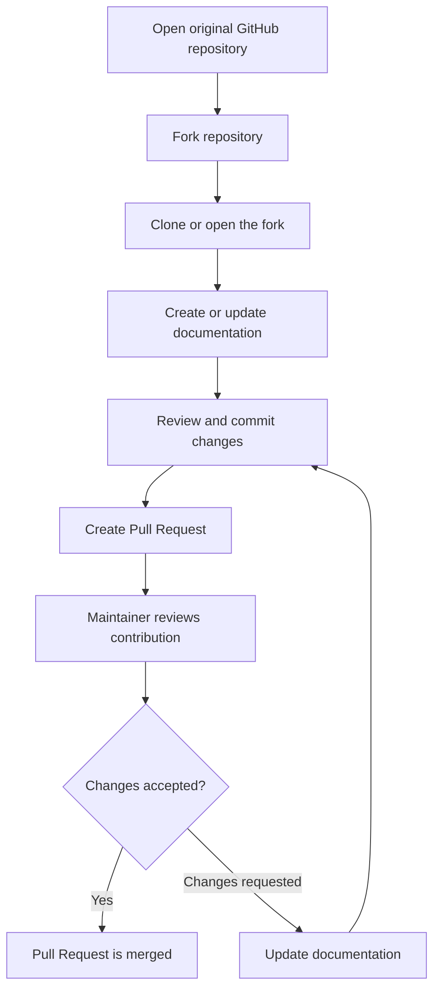

# Open-Source Software Engineering

**Name:** Neha Reddy Ravula  
**USN:** NB25CSE243  
**Assigned Case Study:** Q4 – Open-Source Software Engineering

## 1. Introduction

Open-source software is software whose source code is made available for people to view, use, modify, and share according to its licence. Open-source software engineering is the process of developing and maintaining such software through collaboration among developers and users. Platforms such as GitHub help contributors work on a shared project, track changes, report issues, and review proposed improvements.

In the given case study, a group of developers maintains an open-source Library Management System on GitHub. A student notices that the project does not clearly explain how users can issue and return books. The student can help improve the project by preparing clear documentation and submitting it for review.

## 2. Problem Analysis

The Library Management System lacks proper documentation for two important operations: issuing books and returning books. Without clear instructions, users may not understand the steps they need to follow. This can lead to confusion, incorrect use of the system, and repeated questions to the project developers.

The problem can be addressed by adding or updating a documentation file that explains the issue and return procedures in a simple, step-by-step manner. Since the project is hosted on GitHub, the student can propose the change without directly modifying the original repository.

## 3. Proposed Solution

The student can contribute by following the GitHub fork-and-pull-request workflow.

### 3.1 Forking the repository

1. Sign in to a GitHub account.
2. Open the original Library Management System repository.
3. Click **Fork** to create a copy of the repository under the student's GitHub account.
4. Open the forked repository. The student can make changes to this copy without changing the original project.

### 3.2 Creating or modifying the documentation

1. Open the forked repository and locate its documentation folder, if one exists.
2. Create a Markdown file such as `Book_Issue_and_Return_Guide.md`, or update the existing user guide.
3. Add clear instructions for issuing a book:
   - Sign in to the Library Management System.
   - Search for the required book by title, author, or book ID.
   - Check whether the book is available.
   - Select the issue option and confirm the request.
   - Check the account or issue history for the due date and issue status.
4. Add clear instructions for returning a book:
   - Sign in and open the issued-books or borrowing section.
   - Identify the book to be returned.
   - Follow the system's return procedure or submit the book to the library counter, depending on how the system is designed.
   - Confirm that the return has been recorded and check whether any fine or outstanding amount is displayed.
5. Use screenshots or examples only if they are available and permitted by the project. The instructions should match the actual system; contributors should not invent buttons or functions that the software does not provide.

### 3.3 Committing the changes

After editing the documentation, the student should review the file for spelling, clarity, and correctness. The student then saves the changes as a commit in the forked repository. A commit records the changes made to the project.

Example commit message:

`Improve documentation for book issue and return`

### 3.4 Submitting a Pull Request

1. Open the forked repository on GitHub.
2. Select **Contribute** and then **Open pull request**, or use **Pull requests → New pull request**.
3. Check that the base repository is the original project and the head repository is the student's fork.
4. Select the appropriate branches, usually `main` on both sides.
5. Enter a clear title and description explaining that the documentation for issuing and returning books has been added or improved.
6. Click **Create pull request**.

The project maintainers can review the proposed changes, request corrections if needed, and merge the contribution into the original repository if it is accepted.

## 4. Benefits and Challenges

### Benefits of contributing to open-source projects

- **Practical experience:** Students gain experience working with real project files and development workflows.
- **Collaboration:** Contributors learn to communicate with other developers, respond to feedback, and work towards a common goal.
- **Skill development:** Working with Git, GitHub, Markdown, documentation, and code review improves technical skills.
- **Project improvement:** Clear documentation makes software easier for users to understand and use.
- **Community participation:** Contributions help maintain and improve software that can benefit many people.

### Possible challenges

- **Understanding an unfamiliar project:** A new contributor may need time to understand the repository structure and the software's actual behaviour.
- **Review and feedback:** Maintainers may request changes before accepting a Pull Request. The contributor must understand and address the feedback.

## 5. GitHub Contribution Workflow Diagram

## 6. Conclusion

Open-source software engineering allows developers and users to improve software through shared effort. In this case study, the student contributes by documenting the book issue and return procedures in the Library Management System. By forking the repository, editing the documentation, committing the changes, and submitting a Pull Request, the student follows a standard collaborative GitHub workflow. This improves the project's usability while giving the student practical experience in open-source contribution.
