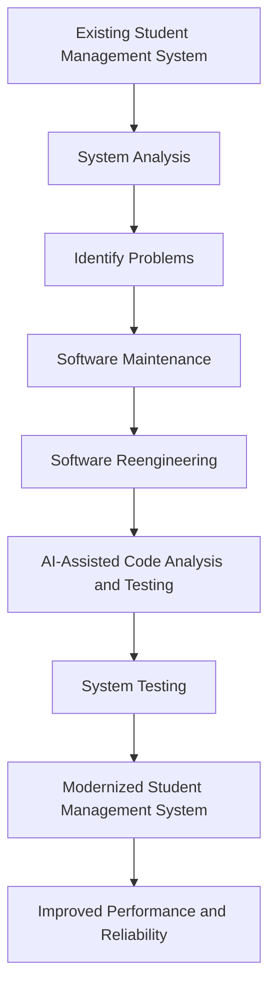

# Software Maintenance, Reengineering, and AI in Software Engineering

**Name:** P. Uday Bhaskar  
**USN:** NB25CSE258  
**Assigned Question:** Question 5 – Software Maintenance, Reengineering, and AI in Software Engineering

## 1. Introduction

Software maintenance is the process of modifying and updating software after its delivery to improve its performance, fix errors and adapt to changing requirements.

Software reengineering is the process of examining and modifying an existing software system to improve its quality, structure and performance without completely developing a new system.

Artificial Intelligence (AI) in software engineering helps developers analyze code, detect errors, automate testing and improve software quality.

These techniques can be used to modernize the existing Student Management System of a college.

## 2. Problem Analysis

The college has been using a Student Management System for several years. Over time, the system has developed several problems:

1. **Slow Performance:** The system takes more time to process student information and generate reports.
2. **Outdated Features:** Some features are old and do not meet current college requirements.
3. **Frequent Errors:** The system produces errors during data entry, processing and report generation.
4. **Difficult Maintenance:** The old software structure makes it difficult for developers to modify and update the system.
5. **Poor User Experience:** Students and faculty members face difficulties while accessing information.

Therefore, the college needs to modernize the existing system using software maintenance, reengineering and AI-assisted techniques.

## 3. Suitable Types of Software Maintenance

Four types of software maintenance can be applied to improve the Student Management System.

### 1. Corrective Maintenance

Corrective maintenance is used to identify and fix errors in the existing software.

**Example:** Fixing errors in student attendance calculations and examination result generation.

### 2. Adaptive Maintenance

Adaptive maintenance modifies software to work with new technologies, platforms or environments.

**Example:** Updating the Student Management System to support new operating systems, browsers and database versions.

### 3. Perfective Maintenance

Perfective maintenance improves software performance and adds new features according to user requirements.

**Example:** Adding online fee payment, improved student dashboards and faster report generation.

### 4. Preventive Maintenance

Preventive maintenance helps prevent future problems by improving the internal structure and quality of software.

**Example:** Removing unnecessary code, improving database structure and updating security components.

## 4. Steps Involved in Software Reengineering

The following steps can be used to reengineer the existing Student Management System.

**Step 1: System Analysis**

Study the existing software and identify its problems, outdated features and limitations.

**Step 2: Code Analysis**

Examine the existing source code to understand its structure and identify errors or unnecessary code.

**Step 3: Database Analysis**

Examine the existing database and identify duplicate records, incorrect data and performance issues.

**Step 4: System Redesign**

Design an improved software structure with better performance, security and user-friendly features.

**Step 5: Code Restructuring**

Modify and improve the existing source code to make it easier to understand, maintain and update.

**Step 6: Testing**

Perform functional testing, performance testing and security testing to ensure the updated system works correctly.

**Step 7: Deployment**

Deploy the modernized Student Management System and provide access to students, faculty and administrators.

## 5. Applications of AI in Software Engineering

AI-assisted tools can improve the development and maintenance of the Student Management System in the following ways.

### 1. AI-Based Error Detection and Code Analysis

AI tools can analyze source code and identify possible errors, bugs and security vulnerabilities.

**Example:** AI-assisted code analysis can help developers identify errors in attendance calculations and student data processing.

### 2. AI-Assisted Software Testing

AI can help generate test cases, automate software testing and identify unexpected system behaviour.

**Example:** AI-assisted testing can check whether student registration, attendance updates and examination result calculations are working correctly.

## 6. Three Expected Improvements

After applying software maintenance, reengineering and AI-assisted techniques, the college can expect the following improvements.

### 1. Improved Performance

Optimizing the source code and database will reduce processing time and make the system faster.

### 2. Better Reliability and Security

Corrective maintenance, preventive maintenance and AI-assisted error detection will help reduce software errors and improve system reliability.

### 3. Modern Features and User Experience

The modernized system can provide an improved user interface, online fee payment, student dashboards and faster report generation.

## 7. Challenges in Software Modernization

Some possible challenges include:

1. **High Cost:** Modernizing old software may require additional resources and investment.
2. **Data Migration:** Transferring existing student records to an improved database can be difficult.
3. **Security Risks:** Student information must be protected during the modernization process.
4. **Compatibility Issues:** New technologies may not work properly with some old software components.

## 8. Modernization Workflow Diagram

## 9. Conclusion

Software maintenance, reengineering and Artificial Intelligence play an important role in improving existing software systems.

In the college Student Management System, corrective, adaptive, perfective and preventive maintenance can solve existing problems. Software reengineering can improve the system structure and performance, while AI-assisted tools can help detect errors and automate testing.

By applying these techniques, the college can develop a modern, reliable, secure and efficient Student Management System without completely replacing the existing software.

Thus, software maintenance, reengineering and AI-assisted techniques provide an effective solution for modernizing the college's Student Management System.
