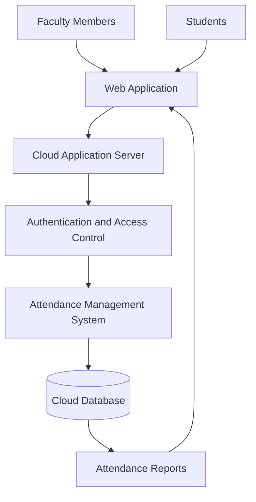

# SaaS-Based Cloud Attendance Management System

**Student Name:** P Sai Bhuvan  
**USN:** NB25CSE259  
**Case Study:** Q1 – SaaS and Cloud-Based Applications

## 1. Introduction to SaaS

Software as a Service (SaaS) is a cloud computing model in which software applications are hosted on cloud servers and provided to users through the internet. Users can access the software using a web browser without installing or maintaining it on their individual computers.

SaaS applications are generally managed by a service provider, which handles software updates, maintenance, storage, and security.

Examples of SaaS applications include Google Workspace, Microsoft 365, and Salesforce.

## 2. Problem Analysis

Currently, the college maintains student attendance records manually using registers and Excel sheets.

This approach creates several problems:

- Maintaining attendance records manually consumes time.
- Calculating attendance percentages can lead to errors.
- Students cannot easily access their attendance information.
- Faculty members need to be physically present to access certain records.
- Managing and storing large amounts of attendance data becomes difficult.

To overcome these problems, the college can implement a cloud-based attendance management system using the SaaS model.

## 3. Proposed SaaS-Based Attendance Management System

The proposed system is a cloud-based application that allows faculty members to record and manage student attendance through an internet-connected device.

Students can log in to view their attendance records and percentage. All attendance information is stored in a centralized cloud database.

The SaaS provider manages the application, database infrastructure, maintenance, and updates.

### Essential Features

1. **User Authentication:** Faculty members and students can securely log in using their credentials.

2. **Attendance Recording:** Faculty members can mark students as present or absent for each class.

3. **Attendance Reports:** The system automatically calculates attendance percentages and generates reports.

4. **Student Dashboard:** Students can view their subject-wise attendance records and overall attendance percentage.

5. **Cloud Data Storage:** Attendance records are stored centrally and can be accessed whenever required through the internet.

## 4. Benefits of Cloud-Based Applications

1. **Anywhere Accessibility:** Faculty members and students can access attendance information from anywhere using an internet-connected device.

2. **Reduced Maintenance:** The SaaS provider manages software updates, server maintenance, and infrastructure, reducing the workload on college IT staff.

3. **Scalability and Cost Efficiency:** The system can support more students and faculty members as the college grows without requiring the college to maintain its own server infrastructure.

## 5. Challenges of SaaS-Based Attendance Management

1. **Internet Dependency:** Users need a stable internet connection to access the cloud-based application. Network failures may temporarily interrupt access.

2. **Data Security and Privacy:** Student attendance records are sensitive information. Unauthorized access, data breaches, and security threats must be prevented through authentication, access control, and data encryption.

## 6. System Architecture Diagram

The following diagram represents the basic architecture of the proposed SaaS-based attendance management system.

### Explanation of Architecture

- Faculty members and students access the system through a web application.
- The cloud application server processes user requests.
- Authentication verifies the identity of users and controls access.
- The attendance management system handles attendance recording and report generation.
- The cloud database stores student details and attendance records.
- Attendance reports are displayed to authorized users through the web application.

## 7. Conclusion

A SaaS-based cloud attendance management system provides an efficient solution to the problems associated with traditional manual attendance management.

It reduces paperwork, minimizes calculation errors, and allows faculty members and students to access attendance records from anywhere.

Although internet dependency and data security are important challenges, they can be addressed through proper infrastructure, authentication, and security measures.

Therefore, implementing a SaaS-based attendance management system can improve the efficiency, accessibility, and reliability of attendance management in a college.
