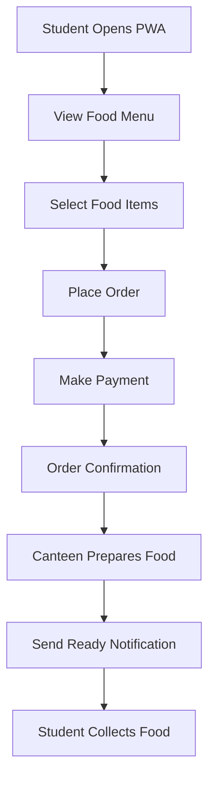

# Online Canteen Food-Ordering System
## Mobile and Web Applications Engineering

**Name:** NALLABOTHULA SUCHET  
**USN:** NB25CSE231  
**Assigned Case Study:** Question 2 – Mobile and Web Applications Engineering

## 1. Introduction

Mobile and web applications are software applications used to provide services through smartphones, computers and other devices.

A college canteen can use an online food-ordering system to allow students to view food items, place orders, make payments and receive notifications.

The system reduces waiting time and makes the food-ordering process easier and more organized.

## 2. Problem Analysis

In a traditional canteen, students need to stand in queues to check the menu, place orders and collect food.

This can cause:
- Long waiting times.
- Crowding in the canteen.
- Difficulty in managing multiple orders.
- Delays in serving students.

To solve these problems, an online food-ordering application can be developed.

## 3. Comparison of Mobile, Web and Progressive Web Applications

**Mobile Application:**
- Installed on smartphones.
- Can provide notifications.
- Requires installation from an app store or another approved source.

**Web Application:**
- Accessed through a web browser.
- Does not require installation.
- Can be used on computers and smartphones.

**Progressive Web Application (PWA):**
- Works through a web browser.
- Can provide an app-like experience.
- Can be added to the home screen.
- Supports notifications on compatible devices and browsers.

## 4. Selection of Suitable Application

A Progressive Web Application (PWA) is suitable for the college canteen food-ordering system.

Reasons:
1. Students can access it through a browser without downloading a separate application.
2. It works on smartphones, tablets and computers.
3. It provides an app-like user experience.
4. It can support order notifications on compatible devices.
5. It is easier to access and maintain through a common application.

Therefore, PWA is a suitable choice for the proposed system.

## 5. Major Functionalities

The canteen food-ordering system should provide the following functionalities:

**1. Menu Display**
- Displays available food items.
- Shows food names and prices.
- Allows students to select their preferred food.

**2. Online Food Ordering**
- Allows students to add food items to their orders.
- Displays the total bill.
- Allows students to confirm their orders.

**3. Online Payment**
- Provides online payment options.
- Displays payment confirmation.
- Helps reduce cash-handling difficulties.

**4. Order Notifications**
- Sends notifications about order status.
- Informs students when their orders are ready.
- Helps students collect their food on time.

## 6. Development Challenges

**1. Internet Connectivity:** Students need a stable internet connection to access the application and place orders.

**2. Payment Security:** The system must protect students' payment details and ensure secure transactions.

**3. Order Management:** Managing multiple orders during busy hours can be difficult. The system should update order status correctly and avoid confusion.

## 7. Application Workflow Diagram

## 8. Benefits of the Proposed System

- Reduces waiting time in the canteen.
- Makes food ordering easier and faster.
- Provides convenient online payments.
- Helps manage orders efficiently.
- Improves the overall canteen experience.

## 9. Conclusion

The online canteen food-ordering system is a useful solution for colleges. A Progressive Web Application is suitable because it is accessible through different devices and does not require a separate application installation.

It provides important features such as menu display, online ordering, payment and notifications. Although there are challenges related to internet connectivity, payment security and order management, the proposed system can make canteen operations more convenient and efficient.
