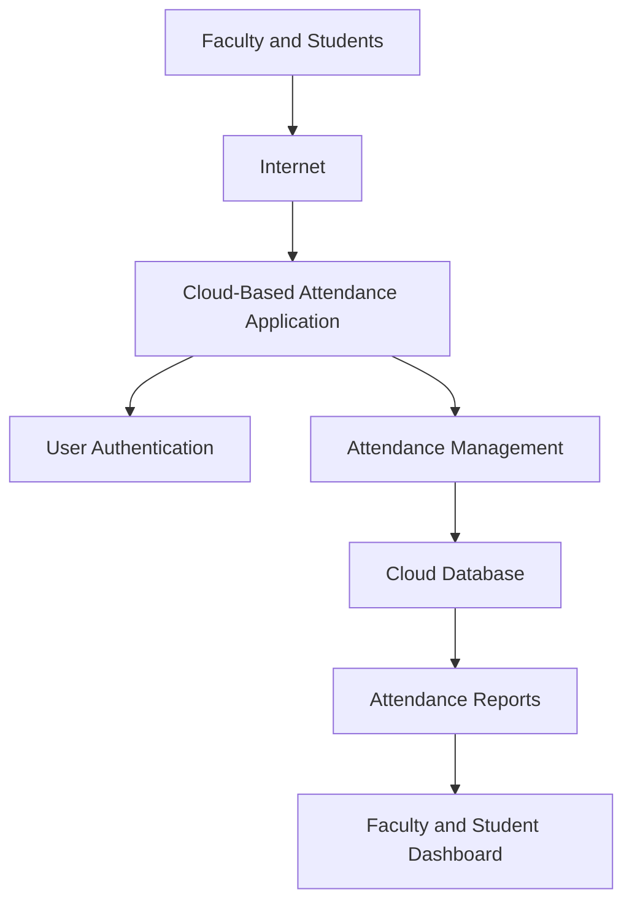

# SaaS-Based College Attendance Management System

**Name:** Pooja V Lad

**USN:** NB25CSE268

**Assigned Case Study:** Question 1 – SaaS and Cloud-Based Applications

## 1. Introduction to SaaS

Software as a Service (SaaS) is a software delivery model in which applications are hosted on cloud servers and accessed through the internet.

Users do not need to install the software on their computers. They can access it using a web browser or mobile application.

Examples of SaaS applications include Google Drive, Microsoft 365 and Zoom.

In a college attendance management system, SaaS can be used to store, manage and track student attendance online.

## 2. Problem Analysis

Currently, the college maintains student attendance records manually using registers and Excel sheets.

This method creates several problems:

- Maintaining attendance records manually takes more time.
- There is a possibility of human errors.
- Finding old attendance records is difficult.
- Students cannot easily check their attendance.
- Preparing attendance reports requires additional effort.

To solve these problems, the college can develop a cloud-based attendance management system using SaaS.

## 3. Proposed Solution

The proposed system is a cloud-based attendance management application that allows faculty members to mark and manage student attendance from anywhere using the internet.

The system stores attendance details securely on cloud servers. Students can log in to view their attendance percentage, while faculty members can mark attendance and generate reports.

### Essential Features

1. **User Login:** Faculty members and students can log in using their username and password.

2. **Attendance Marking:** Faculty members can mark students as present or absent for each class.

3. **Attendance Records:** The system automatically stores attendance details in a central database.

4. **Attendance Reports:** Faculty members can generate daily, monthly and subject-wise attendance reports.

5. **Student Dashboard:** Students can view their attendance records and overall attendance percentage.

## 4. Cloud-Based System Architecture

The architecture of the proposed attendance management system is shown below.

### Explanation

- Faculty members and students access the application through the internet.
- The cloud application verifies user login details.
- Faculty members mark attendance through the application.
- Attendance records are stored in the cloud database.
- Students and faculty members can view attendance reports through their dashboards.

## 5. Benefits of Cloud-Based Applications

1. **Anywhere Access:** Faculty members can access the attendance system from anywhere using an internet connection.

2. **Time Saving:** Attendance marking, storage and report generation become faster and easier.

3. **Centralized Storage:** All attendance records are stored in one central cloud database, making data management easier.

## 6. Challenges of SaaS Applications

1. **Internet Dependency:** The system requires a stable internet connection. Without internet access, users may not be able to access the application.

2. **Security and Privacy:** Student attendance records contain important information. Proper security measures are required to prevent unauthorized access and data leakage.

## 7. Conclusion

The SaaS-based college attendance management system provides an efficient and modern solution for maintaining student attendance records.

It reduces manual work, saves time and allows faculty members and students to access attendance information from anywhere.

By using cloud computing, the college can maintain attendance records more easily, accurately and securely. Therefore, implementing a SaaS-based attendance management system can improve the overall attendance management process.
